# BotVa

[](LICENSE)
[](https://nodejs.org)
[](https://www.typescriptlang.org)

[🇬🇧 English](README.en.md)

Мульти-бот Telegram-платформа на базі Claude AI. Один сервер -- багато ботів, кожен зі своєю роллю, пам'яттю, знаннями та інтеграціями.

<p align="center">
  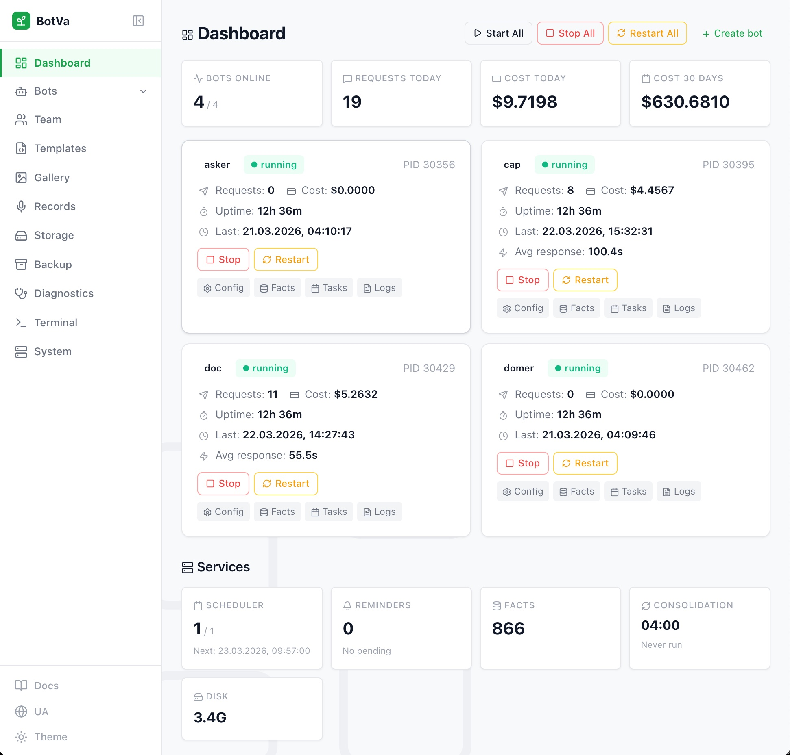
</p>

## Чим BotVa відрізняється

- **Пам'ять як першокласна сутність.** Факти в SQLite (topic, tags, access_count) + щоденні diary-логи розмов + щотижневі консолідації через Claude. Консолідація запускається автоматично щоночі
- **Команда ботів.** Боти спілкуються через Unix-сокети (Colleague MCP), менеджер розподіляє задачі паралельно через `Promise.allSettled()`
- **Повна ізоляція.** Кожен бот -- окремий процес, .env, база, знання, пам'ять, голос, роль. Керуються з однієї адмін-панелі
- **Живе управління.** Веб-панель для створення ботів, галереї зображень, cron-задач, бекапів, діагностики. Модель чату, фонова модель (для сервісних викликів) та reasoning effort змінюються без рестарту, зміни .env потребують рестарту через UI
- **Динамічні інтеграції.** MCP-сервери підключаються за наявності env-змінних -- додав `BITRIX24_WEBHOOK_URL`, перезапустив бота і він отримав CRM. Без зміни коду
- **Філософія.** Базова роль (`_soul.md`) -- маніфест: як думати, як спілкуватись, коли мовчати. Не "certainly!", а людська розмова

## Ключові можливості

<p align="center">
  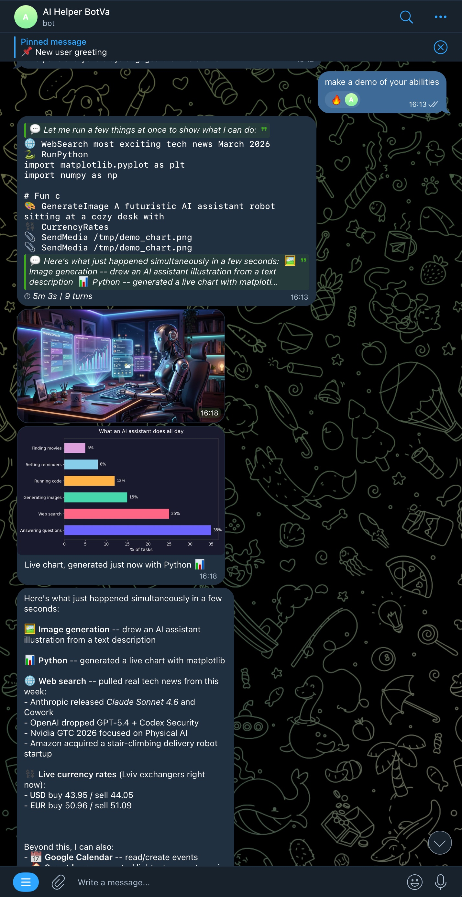
</p>
<p align="center"><em>Паралельне виконання: веб-пошук, генерація зображення, Python-графік, курси валют — одним запитом</em></p>

- **Кілька ботів** з одного інстансу Node.js
- **14 готових ролей** -- від персонального асистента до автономного агента
- **Пам'ять** -- факти з dedup по content-hash, FTS5-пошуком та usefulness-трекінгом, щоденні diary-логи з консолідацією
- **Workspace files** -- 8-шарова збірка CLAUDE.md (SOUL/TOOLS глобальні, BOT_SOUL/BOT_TOOLS/IDENTITY/ROLE/USER/MEMORY per-bot) з feature-flag блоками
- **Голос** -- голосові повідомлення та відповіді (Groq STT + Gemini TTS / Edge TTS / ElevenLabs з ротацією ключів)
- **Зображення** -- генерація та редагування через Gemini з авто-галереєю
- **Gemini AI** -- друга думка (AskGemini) та пошук з цитатами (GeminiSearch)
- **Команда ботів** -- спілкування через Unix-сокети, делегування задач, каталог агентів-спеціалістів з keyword matcher
- **Планувальник** -- cron-задачі та нагадування з режимом `runAgent` (виконати як повноцінний запит з інструментами)
- **Утиліти** -- курси валют, час, Python sandbox, email, Telegraph
- **Інтеграції** -- Google Workspace, розумний дім, будь-які MCP-сервери
- **Веб-пошук** -- пошук, скрапінг, AI-браузер (Stagehand)
- **Адмін-панель** -- повний веб-інтерфейс для управління
- **Аудіо-рекордер** -- фоновий запис з мікрофона (Orange Pi / Mac), VAD-фільтр тиші, транскрипція Whisper
- **Бекапи** -- повні та per-bot, з SHA256-верифікацією

## Швидкий старт

### Встановлення на VPS (найшвидший спосіб)

Відкрий **https://botva-installer.onrender.com/**, введи IP сервера, Telegram-токен -- і через 3-5 хвилин бот працює. Детальніше: [DEPLOY.md](DEPLOY.md)

### Локальне встановлення

```bash
# 1. Клонувати
git clone https://github.com/cohe4ko/BotVa.git BotVa
cd BotVa

# 2. Встановити залежності та зібрати
./scripts/deploy.sh setup

# 3. Створити першого бота (варіант A: CLI)
npm run new-bot -- my-bot personal-assistant --emoji 🧑‍💼 --name "Мій Бот"

# 3. Створити першого бота (варіант B: веб-інтерфейс)
./scripts/deploy.sh admin  # Запустити адмін-панель
#    Відкрий http://localhost:3000 → Create Bot
#    Токен та chat ID вводяться у формі створення

# 4. Налаштувати токени (якщо CLI)
#    Відкрий bots/my-bot/.env:
#    - TELEGRAM_BOT_TOKEN  (отримати у @BotFather в Telegram)
#    - ALLOWED_CHAT_ID     (надіслати /chatid боту після запуску)

# 5. Залогінитись в Claude CLI
#    Запустити адмін-панель → Термінал (/terminal)
#    та пройти логін через підписку (не API key)

# 6. Запустити
./scripts/deploy.sh start
```

Після запуску напиши боту в Telegram -- він відповість.

<details>
<summary>Створення бота через веб-інтерфейс</summary>

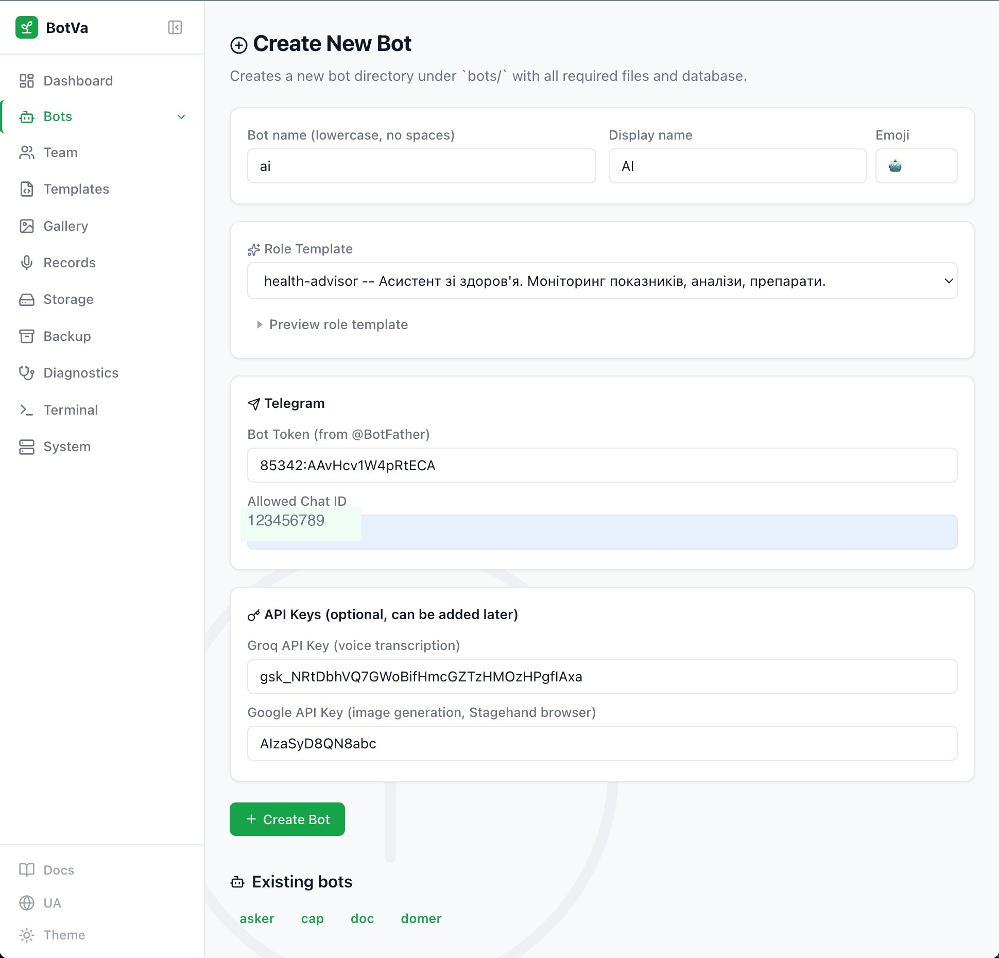

Обери роль, введи Telegram-токен від @BotFather та chat ID. API-ключі можна додати пізніше.

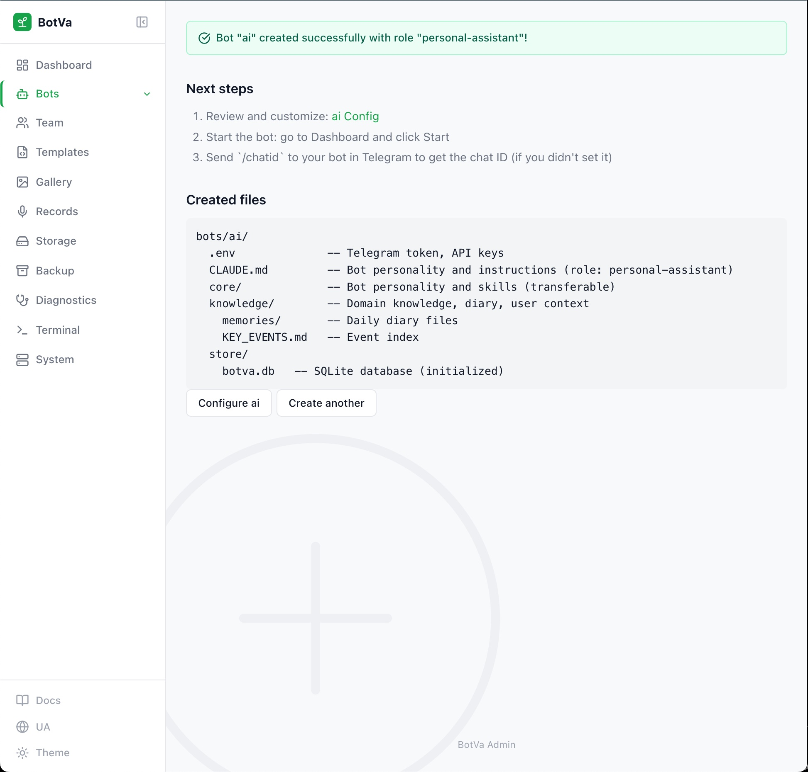

Після створення — структура файлів та наступні кроки.
</details>

## Ролі ботів

При створенні бота обираєш роль -- вона визначає спеціалізацію, інструменти та стиль.

| Роль | Slug | Опис |
|------|------|------|
| Персональний асистент | `personal-assistant` | Повсякденні задачі, розклад, CRM, розумний дім |
| Дослідник | `researcher` | Глибокий аналіз, верифікація фактів, звіти |
| Здоров'я | `health-advisor` | Моніторинг показників, аналізи, рекомендації |
| Академічний | `academic` | Наукові статті, методологія, PhD, викладання |
| Креативний | `creative` | Дизайн, зображення, презентації, копірайтинг |
| Продажі | `sales` | Ліди, угоди, аналіз продажів, пропозиції |
| Планувальник | `planner` | Задачі, дедлайни, пріоритизація |
| База знань | `knowledge-base` | Документація, FAQ, пошук знань |
| Менеджер | `manager` | Координація команди ботів, делегування |
| Продукт/Ринок | `product-market` | CRM-аналітика, позиціонування, конкуренти |
| Вебмайстер | `webmaster` | Сайт, контент, деплой, SEO |
| Дебати та дослідження | `debate-researcher` | Аналіз з протилежних позицій |
| Автономний агент | `autonomous` | Довготривалі задачі без участі користувача, власний `_soul_autonomous.md` |
| Dome Engineer | `dome-engineer` | Інженерні задачі, діагностика, оркестрація технічних workflow |

```bash
npm run new-bot -- <slug> <роль> [--emoji 🤖] [--name "Назва"]
```

## Можливості

### Telegram

Перша взаємодія з ботом — привітання, налаштування профілю, нагадування та пошук з уточнюючими питаннями:

<p align="center">
  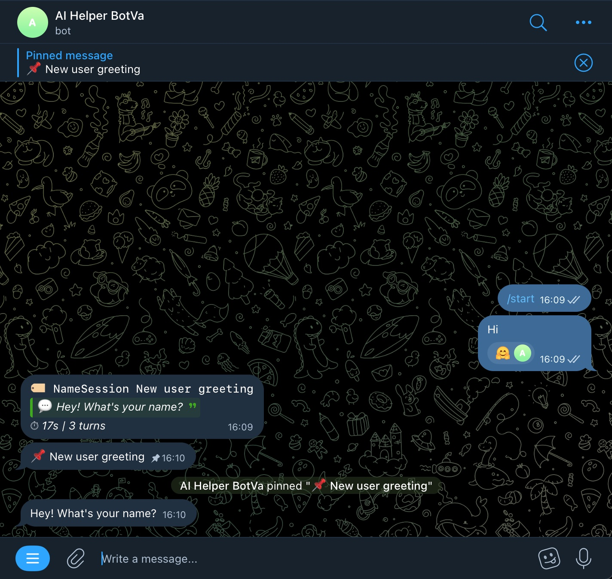
  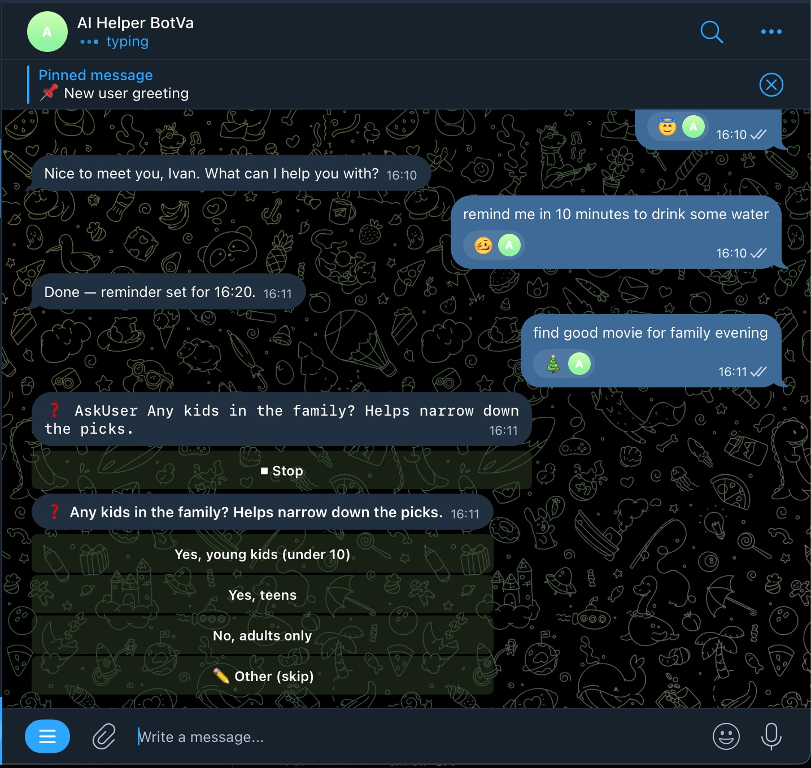
</p>

Повідомлення, надіслане поки бот працює, не перериває його: модель отримує його на найближчій межі кроку і враховує, не повторюючи зроблене. Довгу команду чи субагента можна відправити у фон кнопкою «⏩ У фон» на повідомленні з прогресом — бот одразу перейде до нового повідомлення, а коли задача завершиться, сам напише результат. Фонова задача живе до `BACKGROUND_TASK_MAX_MS` (типово 30 хв) після останньої відповіді.

### Голос

Бот розуміє голосові повідомлення та може відповідати голосом. STT через Groq Whisper (потрібен `GROQ_API_KEY`). Інструмент `TranscribeAudio` дає боту самостійно транскрибувати локальні файли — якщо файл понад 24 MB або в неприйнятному форматі, ffmpeg автоматично перекодовує в 16 kHz mono FLAC і ріже на 25-хвилинні чанки, транскрипти склеюються. Три TTS-провайдери: Gemini TTS (безкоштовно, дефолт — виразні мультимовні голоси через `GOOGLE_API_KEY`, стиль керується промптом, fallback на Edge при помилці/квоті), Edge-TTS (безкоштовно, без лімітів) та ElevenLabs (вища якість, локальний JSON-стор ключів з ручною ротацією, відстеженням ліміту/помилок, fallback на Gemini/Edge при вичерпанні квоти). Провайдери конфігуруються окремо для автовідповідей (`TTS_PROVIDER_REPLY`) та tool-синтезу (`TTS_PROVIDER_TOOL`). Агент сам розмічає емоційний тон озвучки: маркер `[[tone: ...]]` наприкінці відповіді (вирізається з тексту) або параметр `tone` інструмента TextToSpeech — Gemini TTS передає емоцію голосом. Sentence-aware чанкування довгих текстів (до 20 фрагментів) з надсиланням послідовних voice-повідомлень. Голоси, швидкість, stability/similarity — через вкладку `/audio` в адмінці. Команда `/voice` вмикає/вимикає голосові відповіді, `/usage` показує статус ключів ElevenLabs.

### Зображення

Генерація та редагування через Gemini (`GOOGLE_API_KEY`). Команда `/img опис` або просто попроси в чаті. Всі зображення зберігаються в галереї.

### Пам'ять

Трирівнева система: факти (постійне сховище з topic та tags), щоденні markdown-логи, workspace-файли (USER.md, MEMORY.md). Консолідація о `NIGHT_OWL_HOUR`.

<p align="center">
  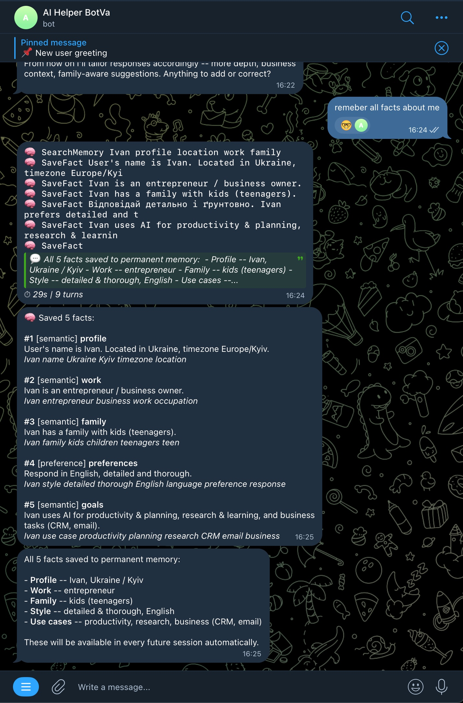
  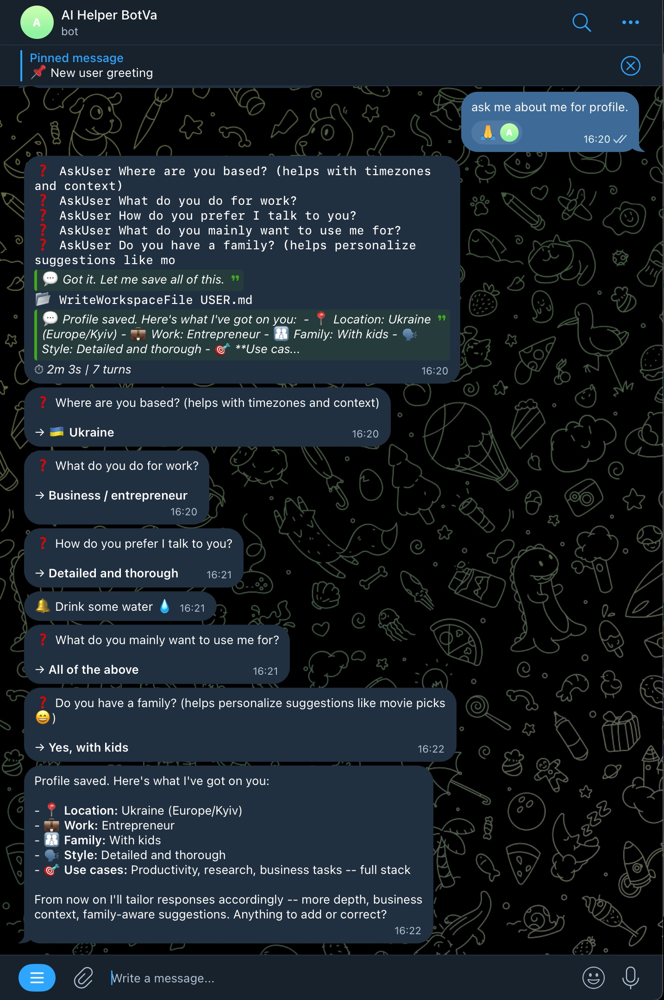
</p>
<p align="center"><em>Ліворуч: збереження фактів через SaveFact/SearchMemory. Праворуч: заповнення профілю через AskUser</em></p>

### Планувальник

Cron-задачі: `/schedule 0 9 * * * Що в мене на сьогодні?`. Стандартний 5-полевий cron.

### Команда ботів

Менеджер координує роботу, боти спілкуються через Colleague MCP (Unix-сокети). Кожен бот може звернутись до менеджера через `ask_manager()`.

Нового бота можна створити без @BotFather: CreateBot без токена надсилає кнопку, що відкриває вікно створення бота в самому Telegram, — після підтвердження бот отримує токен, доступ до нього лишається тільки власнику. Потрібно один раз увімкнути керування ботами для бота-творця в @BotFather Mini App. RotateBotToken замінює токен такого бота, якщо старий витік.

### Боти інших людей (TGAP)

Бот може напряму спитати бота іншої людини (`AskExternalBot`): «спитай у @petro_bot, коли Петро вільний». Бот друга готує чернетку з read-only інструментами, показує її власнику з кнопками «Надіслати / Змінити / Відхилити / Заблокувати», і лише після підтвердження відповідає. Відповідь чесно позначає, чи її підтвердив власник. Невідомі боти, ліміти ходів і rate limit, захист від зациклення — за протоколом [TGAP](docs/tgap-spec.md). Замість однієї чернетки власник бачить 2–3 варіанти, що різняться по суті (відповісти повністю, частково, відмовити), і надсилає потрібний кнопкою «✅ 1/2/3»; «🔄 Інакше» — написати своїми словами, що змінити, і отримати нові варіанти; «✏️ Свій текст» — надіслати власний. Пропозиції (TGAP Extended): «домовся з @x_bot про зустріч» іде як `proposal`, інша сторона погоджується, відмовляє або пропонує інакше; якщо власник назвав межі («будь-який день після 14:00»), бот після підтвердження кнопкою сам погоджується або торгується в їх межах, а все поза ними приносить власнику. Межі тій стороні не показуються, підсумок домовленості приходить власнику. `ManageExternalBots` — список ботів і рівні довіри. Відповідь на питання повертається в той чат, звідки його поставили, а картки на схвалення вхідних запитів — завжди власнику (перший id в `ALLOWED_CHAT_ID`).

Вмикається `TGAP_ENABLED=1` у `.env` бота; потрібен Bot-to-Bot Communication Mode у @BotFather для обох ботів. `TGAP_OWNER_NAME` — ім'я у «візитці» бота (порожнє — анонімно), `TGAP_ACCEPT_FROM=known_only` — відмовляти невідомим ботам, `TGAP_DRAFT_TOOLS` — додаткові read-only MCP-інструменти для чернетки (`mcp__<server>__<tool>`, через кому).

### Секрети

Логіни, паролі й ключі API лежать у зашифрованому сховищі бота. Власник додає їх командою `/secret add <назва>`, а повідомлення зі значенням бот одразу видаляє. Агент бачить лише назви (ListSecrets) і пише `{{secret:назва.поле}}` у виклику інструмента: значення підставляється перед запуском і вирізається з результату, тому не потрапляє ні в контекст моделі, ні в історію сесії. У повідомлення, листи, пам'ять і запити до інших ботів секрет не підставляється. Боту іншої людини на BotVa секрет можна передати через TGAP: кнопка «🔑 Передати секрет» на картці запиту, `/secret share` або ShareSecret. Секрет іде зашифрованим під X25519-ключ отримувача, і його власник вирішує, чи прийняти. Передачу можна відкликати в `/secret` або в адмінці (вкладка «Секрети»); бот на тому боці видаляє секрет сам.

Логін, збережений у Google Chrome на тому ж Mac, можна взяти прямо звідти: в адмінці (вкладка бота «Секрети» → «Імпорт з Google Chrome»: список збережених логінів з пошуком, назва і кнопка «Імпортувати»), командою `/secret import <назва> <сайт>` або словами агенту («візьми пароль від сайту з хрому»), тоді він викликає ImportBrowserSecret і власник обирає логін кнопкою. Пароль іде з Chrome одразу в сховище і не проходить ні через чат, ні через Telegram, ні через модель. Під час першого імпорту macOS може попросити доступ до запису «Chrome Safe Storage» у Keychain.

### Telegram

Режим сесій у `/settings`: **Назва** (одна розмова, бот називає її через NameSession) або **Топіки** — кожен топік особистого чату окрема розмова зі своєю сесією (топіки вмикаються для бота в @BotFather).

SendMedia (фото, документи, альбоми), SendChecklist (список задач/покупок з чекбоксами), ForwardMessage, SetReaction (реакція emoji + зняття реакції), PinMessage, OpenWebApp (Mini App), AskUser (кнопки, poll із зображеннями в опціях).

### Утиліти

CurrencyRates (готівкові курси), GetCurrentTime, RunPython (ізольований: без мережі й ключів, пише лише у свій каталог, файли користувача — тільки на читання), SendEmail (SMTP), PublishTelegraph, ShareFile (файл, папка або `.zip`/`.tar.gz` -- багатофайлова сторінка розгортається на сервері в окрему теку з `index.html`).

### Workspace Files

Бот читає та оновлює свої файли між сесіями: USER.md (профіль), MEMORY.md (пам'ять) через ReadWorkspaceFile / WriteWorkspaceFile.

Детальний посібник: [MANUAL.md](MANUAL.md)

## Інтеграції

Будь-який [MCP-сервер](https://modelcontextprotocol.io) можна підключити через `mcp-servers.json`.

**Вбудовані (в комплекті):**

| Інтеграція | MCP-сервер | Потрібні змінні |
|------------|-----------|-----------------|
| Playwright (headless Chrome) | `playwright-remote` | -- |
| Stagehand (AI-браузер) | `stagehand` | `GOOGLE_API_KEY` |
| Google Calendar, Gmail, Drive | `google-workspace` | `GOOGLE_OAUTH_CLIENT_ID`, `GOOGLE_OAUTH_CLIENT_SECRET` |
| Home Assistant | `home-assistant` | `HA_URL`, `HA_TOKEN` |
| Telegram Observer (особистий акаунт) | `telegram` | `TELEGRAM_API_ID`, `TELEGRAM_API_HASH` |

Інші MCP-сервери (CRM, реклама, наукові бази тощо) додаються як запис в `mcp-servers.json` та увімкнюються в адмінці System → MCP Servers.

Сервер може мати передумову. `envVars` — потрібні змінні оточення; `requiresFile` — файли, які мають існувати (шляхи від кореня проєкту). Друге потрібне там, де сервер вмикається не налаштуванням, а дією: `telegram` віддає інструменти лише після того, як акаунт справді підключили, бо саме тоді з'являється `store/telegram.session`. Файл переживає обрив зв'язку і рестарт демона, тож інструменти не зникають на час недоступності — вони просто не з'являються, поки нічого не підключено.

## Аудіо-рекордер (Listener)

Система фонового запису аудіо з мікрофонів, автоматична транскрипція (Groq Whisper) та аналіз через Claude.

**Компоненти:**

| Компонент | Опис | Розташування |
|-----------|------|-------------|
| Receiver | HTTP-сервер, приймає WAV, транскрибує, аналізує | `scripts/orange-pi-listener/receive-transcript.ts` |
| Orange Pi Listener | Python-демон для SBC з мікрофоном | `scripts/orange-pi-listener/listener.py` |
| Mac Listener | Electron tray app для macOS | `scripts/mac-listener/` |

**Як працює:**

1. Пристрій записує аудіо чанками (за замовчуванням 5 хв)
2. VAD (Voice Activity Detection) фільтрує тишу — чанки з < 15% мовлення пропускаються
3. Чанки з голосом відправляються на Receiver (`POST /audio`, multipart WAV)
4. Receiver транскрибує через Groq Whisper та зберігає щоденні конспекти

**Mac Listener (tray app):**

```bash
cd scripts/mac-listener && npm install && npm start
```

Env: `UPLOAD_URL=http://host:3847/audio`, `DEVICE_ID=mac-1`. Два режими: Toggle (ручний старт/стоп) та Continuous (автоматичні чанки). Вимагає `ffmpeg`.

**Receiver:**

```bash
npx tsx scripts/orange-pi-listener/receive-transcript.ts
```

Env: `GROQ_API_KEY` (або `GROQ_API_KEYS`), `LISTENER_PORT=3847`, `ANTHROPIC_API_KEY` (для аналізу).

Пристрої відображаються в адмін-панелі System → Recorder.

## Telegram Observer

Демон, який тримає MTProto-сесію **особистого акаунта** власника (не бота), логує переписку і дає ботам інструменти діяти від його імені.

**Компоненти:**

| Компонент | Опис | Розташування |
|-----------|------|-------------|
| Демон | GramJS-клієнт, лог, MCP-сервер | `src/telegram/daemon.ts` |
| MCP-shim | Pipe stdio ↔ Unix socket | `mcp-servers/telegram/` |
| Керування | start / stop / restart / status / install / uninstall | `scripts/telegram-observer.sh` |
| Адмінка | Підключення, чати, лог | Розділ **Telegram** |

**Налаштування:**

1. Отримати `TELEGRAM_API_ID` і `TELEGRAM_API_HASH` на [my.telegram.org](https://my.telegram.org) → API development tools, додати в `.env`
2. Адмінка → Telegram → ввести номер → код із Telegram → пароль 2FA (якщо є)
3. Запустити демон кнопкою в адмінці або `scripts/telegram-observer.sh start`
4. Увімкнути сервер `telegram` в `mcp-servers.json` (System → MCP Servers). Інструменти з'являться в ботів лише після успішного логіну — до того сервер значиться з умовою «Telegram підключено»
5. `scripts/telegram-observer.sh install` — під launchd з автопідйомом після збою (робить і `deploy.sh launchd`)

**Стійкість до обривів мережі:**

| Механізм | Що робить |
|----------|-----------|
| Нескінченний переконект | GramJS пробує відновити зв'язок без обмеження спроб — обрив будь-якої тривалості не вбиває демон |
| Watchdog | Кожні 5 хв звіряє лічильник апдейтів; якщо той стоїть — перевіряє зв'язок реальним запитом, потім перепідключається, а після двох невдач виходить з кодом 1 |
| launchd `KeepAlive` | Піднімає демон після падіння або виходу watchdog'а; штатний `stop` (вихід 0) лишає його зупиненим |

**Режими чатів** — задаються в адмінці, дефолт залежить від типу:

| Режим | Лог | Витяг фактів | Дефолт для |
|-------|-----|--------------|-----------|
| `ignore` | ні | ні | боти, супергрупи, канали |
| `log-only` | так | ні | приватні чати, базові групи |
| `facts-only` | так | факти | — |
| `full` | так | факти + задачі | — |

Чати з ботами завжди `ignore` за замовчуванням, щоб демон не читав відповіді власних ботів BotVa.

**MCP-інструменти для ботів:**

| Tool | Що робить | Гейт |
|------|-----------|------|
| `tg_list_chats` | Список чатів (з логу або живий) | — |
| `tg_unread` | Чати з непрочитаними | — |
| `tg_read_chat` | Останні повідомлення чату | — |
| `tg_search` | Пошук по архіву переписки | — |
| `tg_resolve` | Знайти chat_id за @username чи назвою | — |
| `tg_send_message` | Надіслати повідомлення | allowlist + ліміт 10/год, 30/добу |
| `tg_send_file` | Надіслати файл або фото | allowlist + ліміт |
| `tg_mark_read` | Позначити чат прочитаним | — |
| `tg_chat_state` | Живий стан чату: непрочитані, до якого дочитав власник | — |
| `tg_my_messages` | Тільки повідомлення власника в чаті (фільтр на боці Telegram) | — |
| `tg_seed_chat` | Наповнити локальний архів чату: свіжа історія + власні повідомлення | — |
| `tg_chat_members` | Склад групи — саме учасники, а не ті, хто писав | — |
| `tg_people` | Довідник людей: канонічне ім'я, роль, активність | — |
| `tg_name_person` | Записати, хто ця людина: ім'я, роль, алаяси, нотатка | — |
| `tg_contact_note` | Профіль у Telegram: нотатка, чи в контактах, шлях до аватара | — |
| `tg_write_note` | Записати нотатку в профіль контакту (видно з телефона й десктопа) | лише для тих, хто в контактах |
| `tg_add_contact` | Додати людину в контакти власника за peer/@ніком, з іменем і нотаткою | номер не розкривається без `share_phone` |
| `tg_import_contact` | Додати контакт **за номером телефону** — повноцінний, придатний для картки | номер вивантажується в Telegram для пошуку збігу |
| `tg_send_contact` | Надіслати комусь контакт іншої людини — карткою або файлом `.vcf` | allowlist + ліміт; картка потребує видимого номера |

Відправка дозволена лише в чати з увімкненою галочкою «Відправка» в адмінці; кожна дія пишеться у вихідний журнал. Бот має показати чернетку і отримати підтвердження через `AskUser` перед викликом `tg_send_*`.

**Позначки прочитання.** Читання (`tg_read_chat`, `tg_search`, лог) не змінює read-state — спостереження непомітне для співрозмовника. А от `tg_send_*` перед відправкою позначає чат прочитаним: інакше співрозмовник бачить відповідь при непрочитаних своїх повідомленнях, що виглядає неприродно. Вимикається параметром `mark_read: false`.

**Люди.** Довідник `tg_people` наповнюється сам із логу — кожне вхідне повідомлення оновлює ім'я, @username, лічильник і дату останнього контакту, без жодного зайвого запиту до Telegram. Понад це можна проставити **канонічне ім'я** (витісняє те, як людина підписана в Telegram), **роль** (дружина, підрядник, замовник), алаяси й нотатку — вручну в адмінці або ботом через `tg_name_person`. Роль — це те, що робить факт осмисленим: «приїду в четвер» від дружини і від підрядника означає різне.

**Задачі з планувальника.** Агент, запущений по cron чи нагадуванню з `runAgent`, отримує Telegram — але **без інструментів, що пишуть іншим людям**: `tg_send_message`, `tg_send_file`, `tg_send_contact` не просто відхиляються, а не потрапляють у контекст моделі (`disallowedTools`). Читання, нотатки й контакти лишаються: вони живуть усередині акаунта власника й оборотні, а повідомлення від його імені о третій ночі — ні. Список «що відправляє» — у `src/telegram/tool-names.ts`, і тест падає, якщо з'явиться новий `tg_send_*`, не доданий туди. `AskUser` у планувальнику немає свідомо: питати нікого, а питання в порожню кімнату — це зависла задача.

**Облік запитів.** Кожен виклик до Telegram проходить через спільний темп: один запит за раз, 700 мс + до 500 мс джитера, денна стеля 3000 і глобальна пауза на весь `FLOOD_WAIT`. Лічильник живе в `tg_api_calls` **за датою і за міткою виклику**, а не в пам'яті процесу — інакше рестарт обнуляв би стелю, і цикл, який ллє запити й падає, обходив би її назавжди. Мітка потрібна, щоб на стрибок споживання можна було відповісти «що саме це було»: у рядку здоров'я поруч із сумою стоять найбільші витратники (`catchUp.getMessages 26, users.getFullUser 3`). Проба сторожа рахується окремим шляхом — вона не пейситься і не відмовляється по бюджету, бо відмова читалася б як мертвий зв'язок і демон рестартував би себе через число в лічильнику.

**Аватари.** `tg_contact_note` віддає **шлях до файлу**, не зображення: аватар лягає в `workspace/telegram/media/avatars/<peer_id>_<photo_id>.jpg` і качається один раз. У назві стоїть id самої фотографії, тож змінений аватар — це інший файл, а незмінений не тягнеться вдруге ніколи.

**Дві нотатки.** `tg_people.note` — наша, у `store/telegram.db`, її бачить лише система. Нотатка в самому профілі контакту (`tg_contact_note` / `tg_write_note`) — Telegram'ова, та, що в клієнті підписана «only visible to you»: вона з'являється біля людини на телефоні й десктопі власника, тобто в той момент, коли він із нею говорить. `tg_write_note` за замовчуванням пише в обидві. Нотатка живе на **контакті** — для людини поза контактами Telegram не має де її тримати, тож спершу `tg_add_contact`. Разом із карткою контакту нотатка **не передається**: у `inputMediaContact` такого поля немає, вона лишається в акаунті власника. `tg_send_contact` шле картку від імені власника і має окремий параметр `comment` — підпис під карткою, який **прочитає отримувач**. Приватна нотатка туди не підставляється ніколи: у цьому й сенс окремого параметра.

**Два способи додати контакт.** `tg_add_contact` бере peer або @нік — швидко, але контакт виходить **без номера**, і карткою його вже не надішлеш. `tg_import_contact` бере номер і йде через `contacts.importContacts`, як синхронізація адресної книги телефона: це єдиний шлях до контакту, який Telegram вважає повноцінним. Номер при цьому вивантажується в Telegram для пошуку збігу; якщо акаунта на ньому немає — просто нічого не знайдеться, нікому нічого не надсилається. `tg_add_contact` теж приймає `phone`, якщо номер відомий заздалегідь.

**Картка існує лише разом із номером.** `inputMediaContact` адресується телефоном, і якщо номер власнику не видно — а так буває завжди, коли людину додали в контакти односторонньо, без обміну номерами, — Telegram відповідає `MEDIA_EMPTY`. Непорожній vCard цього не рятує (перевірено на живій відправці: помилка та сама). Тому `tg_send_contact` відмовляє одразу, називаючи людину і @нік, і підказує два робочі шляхи.

**Файл `.vcf` (`as_file: true`)** — обхід цього обмеження: вимога номера належить саме медіа `inputMediaContact`, а документ її не має. Нік у файлі записаний одразу чотирма способами, бо адресні книги не сходяться в тому, де живе месенджер-профіль: `item1.IMPP;X-SERVICE-TYPE=Telegram;type=pref:x-apple:<нік>` з міткою `X-ABLabel` (те, що пише сам Apple Contacts при експорті — рендериться натисканою Telegram-строкою), `X-SOCIALPROFILE` (читають Apple і Google), розмічений `URL:https://t.me/<нік>` і те саме плоским текстом у `NOTE`. Плюс `X-TELEGRAM-ID` — не для зв'язку, а як ідентифікатор, що переживе зміну ніка. Отримувач імпортує файл у контакти телефона одним дотиком. Перевірено на живій відправці людини без видимого номера. Другий шлях — просто текстом через `tg_send_message`.

Типово картка йде з порожнім vCard — так само, як коли ділишся контактом із самого Telegram. Прапорець `attach_note` вкладає **той самий** `comment` ще й усередину картки (`NOTE:` у vCard): жоден клієнт його не малює, але сервер зберігає (перевірено на живій відправці) і він потрапляє в адресну книгу, коли отримувач збереже контакт у телефон. Тобто підпис читається один раз і зникає в стрічці, а вкладений лишається з людиною. Вкладається саме `comment`, а не якийсь інший текст — щоб нічого невидимого для отримувача не їхало. Без `comment` прапорець — помилка, а не тихий no-op.

Склад групи — окрема річ від того, хто в ній писав: мовчазного учасника в лозі не видно, а той, хто вийшов, лишається в ньому назавжди. `tg_chat_members` з `refresh=true` тягне склад із Telegram (базова група — один запит, супергрупа — сторінками по 200) і чесно каже, скільки з якої кількості видно, бо неадміну Telegram віддає не всіх.

**Витяг фактів (Tier 1).** Для чатів у режимі `facts-only` або `full`, яким у колонці «Аналіз» призначено бота-приймача. Розмова накопичується в буфері й розбирається, коли настає перше з: 4 хвилини тиші, 25 повідомлень, 30 хвилин від першого повідомлення; між двома розборами одного чату — не менше хвилини.

| Що витягається | Куди |
|---|---|
| `facts`, `contacts` | факт, sector `semantic` |
| `events` | факт, sector `episodic` |
| `commitments_mine` — власник пообіцяв | факт + нагадування |
| `commitments_theirs` — власнику пообіцяли | факт + нагадування |
| `requests` — власника попросили | факт + нагадування |
| `dates` — зустріч чи дедлайн сам по собі | факт + нагадування |

Вхідне «зроби до п'ятниці» і вихідне «зроблю до п'ятниці» — різні речі з протилежними наслідками, і промт розрізняє їх явно. Кожен пункт зобов'язаний нести дослівну цитату і `msg_ids`: без них факт неможливо ані перевірити, ані зняти, коли джерело відредагують.

| Впевненість | Що робиться |
|---|---|
| ≥ 0.75 | пишеться в пам'ять одразу; задача з датою заводить нагадування |
| 0.45–0.75 | у чергу ревізії в адмінці |
| < 0.45 | лишається тільки в лозі |

Задача без дати ніколи не заводить нагадування автоматично — йде в чергу, де дату можна проставити руками. Перед записом кандидат звіряється з наявними фактами бота за embedding: збіг понад 0.9 не створює дубль, а піднімає корисність наявного факту. Редагування або видалення повідомлення позначає похідні пункти як `stale` — не видаляє мовчки. Стеля: 200 розборів на добу і 40 на годину; після вичерпання логування триває, аналіз чекає до півночі.

**Пропущене за час простою.** MTProto віддає апдейти лише в живе з'єднання, тож рестарт демона лишав би діру в лозі. При старті демон добирає пропущене через `messages.getHistory`: від збереженого курсора (останній залогований `msg_id` у чаті), а для чату, побаченого вперше — останні 20 повідомлень. Не бекфіл: чати в режимі `ignore` пропускаються, між чатами пауза, `FLOOD_WAIT` обробляється відступом.

**Ізоляція за акаунтом.** Кожен рядок підписаний власником MTProto-сесії: `direction` (вхідне/вихідне) має сенс лише відносно конкретного акаунта, і той самий `chat_id` під іншим логіном означає протилежне. Дані попереднього акаунта лишаються в базі, але не показуються, не шукаються й не рахуються; адмінка показує їх кількість і пропонує видалити.

**Автовідповідь у чаті.** Чат можна закріпити за конкретним ботом: якщо вхідне повідомлення провисіло без відповіді довше за поріг, бот відповідає від імені власника на основі контексту переписки.

| Параметр | Де | Дефолт |
|---|---|---|
| Бот-відповідач | Telegram → Чати → колонка «Автовідповідь» | вимкнено |
| Поріг мовчання | там само | 5 хв (від 30 с до 3 год) |
| «Лише непрочитане» | там само | увімкнено |
| «Лише згадки» | там само | увімкнено для груп, вимкнено для приватних |
| Промт | Telegram → чат → «Промт автовідповіді» | порожньо |

**Сесія і стиль.** Одна тривала сесія агента на чат (`tg:<chat_id>`). На старті сесії — прайминг: до 200 повідомлень цієї переписки (150 для групи, плюс окремий блок з 50 власних реплік у ній) з інструкцією розібрати, як власник пише саме тут. Довгі повідомлення власника обрізаються, а не викидаються. Далі кожен хід тонкий: усе, що сталося з моменту, коли сесія востаннє дивилась — включно з повідомленнями, які власник написав сам. Якщо розрив більший за 120 повідомлень, промт прямо каже, скільки лишилося за кадром.

**Через Telegram Business.** Якщо підключити бота в акаунті власника (Settings → Chat Automation, без Premium) і дозволити йому відповідати, автовідповіді в особистих чатах, які покриває Chat Automation, ідуть офіційним шляхом — `sendMessage` з `business_connection_id`, без надсилання з userbot-сесії. Коли і чи відповідати, як і раніше вирішує автовідповідач за логом обсервера; змінюється лише транспорт. Групи, проактивні повідомлення й відповіді поза 24-годинним вікном лишаються на обсервері. Чат має бути закріплений саме за тим ботом, якого підключено в Chat Automation; підключення приймається лише від власника (`ALLOWED_CHAT_ID`). Потрібен Secretary Mode для бота в @BotFather.

**Групи.** Перед першим праймингом групи з автовідповідачем архів наповнюється: 100 останніх повідомлень + до 50 власних (`tg_seed_chat`, два запити, разово на чат). Тригер — лише звернення до власника: `@username` у тексті або відповідь на його повідомлення. Відлік мовчання йде від останнього повідомлення того, хто звернувся, тож інші учасники, які продовжують розмову, не блокують відповідь нескінченно.

**Ритм і межі.** Перевірка без моделі — чисті SQLite-читання; інтервал іде за найкоротшим порогом (30 с → такт 10 с, стеля хвилина). Модель запускається лише коли всі умови зійшлися. Одна відповідь на повідомлення; пауза між відповідями дорівнює порогу; живий запит read-state у Telegram перед кожною відправкою (якщо власник відкрив чат — бот мовчить), з бек-офом, щоб не смикати API. Бот може відмовитись відповідати — тоді власник отримує сповіщення в чат із цим ботом, а подія лягає в журнал зі статусом «змовчав». Відправка потребує увімкненої галочки «Відправка» і рахується в загальний ліміт.

Транспорт — Unix socket `store/telegram.sock` (права 600), не TCP-порт. Сесія — `store/telegram.session` (права 600, у gitignore); відкликати доступ можна в Telegram → Settings → Devices.

**MTProto-шар.** GramJS публікує шар 198 і не оновлюється з лютого 2025, тож поля, додані Telegram після нього, недоступні. Класи GramJS будує на старті з TL-схеми, яка лежить рядком у `tl/apiTl.js` — тому `scripts/patch-gramjs.mjs` (postinstall) підміняє її схемою 222 з `vendor/telegram-api-222.tl` і піднімає константу `LAYER`. Патч самоскасовний: щойно апстрім випустить 222 або новіше, скрипт нічого не робить.

План подальших фаз (витяг фактів і задач у пам'ять бота): [docs/telegram-observer.md](docs/telegram-observer.md)

## Адмін-панель

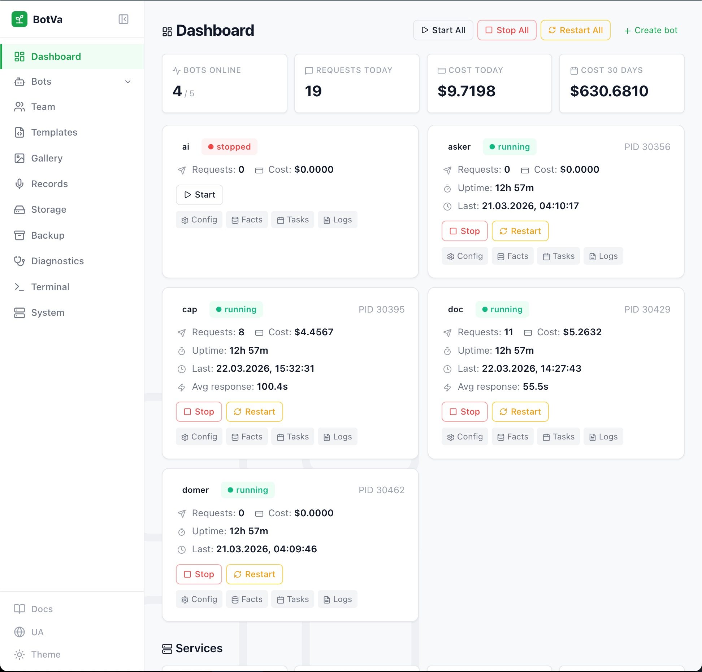

Веб-інтерфейс для управління ботами. Два способи запуску:

```bash
# 1. З Telegram (on-demand, автостоп через 20 хв)
/admin

# 2. Як окремий сервіс (постійний)
./scripts/deploy.sh admin
```

Машина за NAT, файрволом чи з динамічною IP: кнопка «🌐 Доступ ззовні» під `/admin` піднімає тимчасовий тунель і дає https-посилання, що відкривається звідусіль. Без налаштувань: Cloudflare Quick Tunnel, якщо встановлений `cloudflared`, інакше localhost.run через системний `ssh`. Тунель відкривається лише на запит і закривається разом з адмінкою; доступ, як і локально, — за одноразовим токеном у посиланні (TLS завершується на боці провайдера тунелю).

| Розділ | Що робить |
|--------|-----------|
| Dashboard | Статус ботів, запити, витрати, сервіси |
| Config | Модель чату, фонова модель, reasoning effort, env-змінні, workspace files (8 шарів) |
| Knowledge | Файли знань бота |
| Facts | Пам'ять: перегляд, пошук, редагування, FTS5-пошук |
| Tasks | Нагадування та cron-задачі з повним редагуванням (текст, розклад, runAgent) |
| Settings | Налаштування чатів, сесії |
| Secrets | Сховище секретів бота (назви й поля, без значень), видалення, передачі через TGAP із відкликанням, імпорт логінів із Google Chrome |
| Usage | Аналітика токенів та витрат |
| Audio | TTS-провайдери (Gemini / Edge / ElevenLabs), вибір голосів, стиль Gemini, параметри швидкості/якості, ключі ElevenLabs з лічильниками |
| System | Builtin tools, MCP servers, skills on/off |
| Images | Галерея згенерованих зображень |
| Logs | Аудит подій |
| Diagnostics | AI-діагностика системи |
| Backup | Створення та відновлення бекапів |
| Team | Управління командою ботів |
| Templates | Шаблони ролей |
| Terminal | Браузерний shell |
| Telegram | Telegram Observer: підключення акаунта, статус демона, чати з режимами й ботом-приймачем, довідник людей, черга ревізії витягнутого, лог вхідних/вихідних, вихідні дії ботів |
| Create Bot | Майстер створення нового бота |

Детальний посібник: [MANUAL.md](MANUAL.md)

## Telegram-команди

<p align="center">
  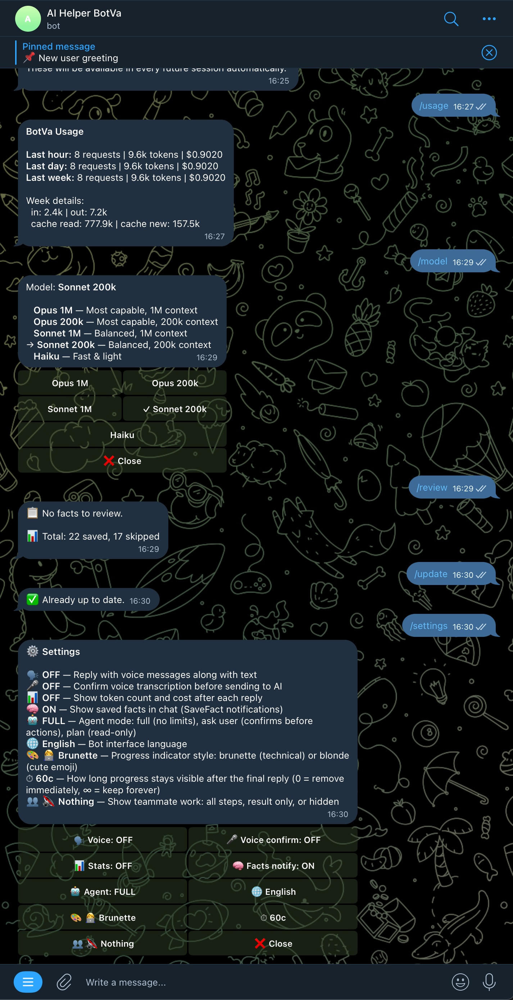
  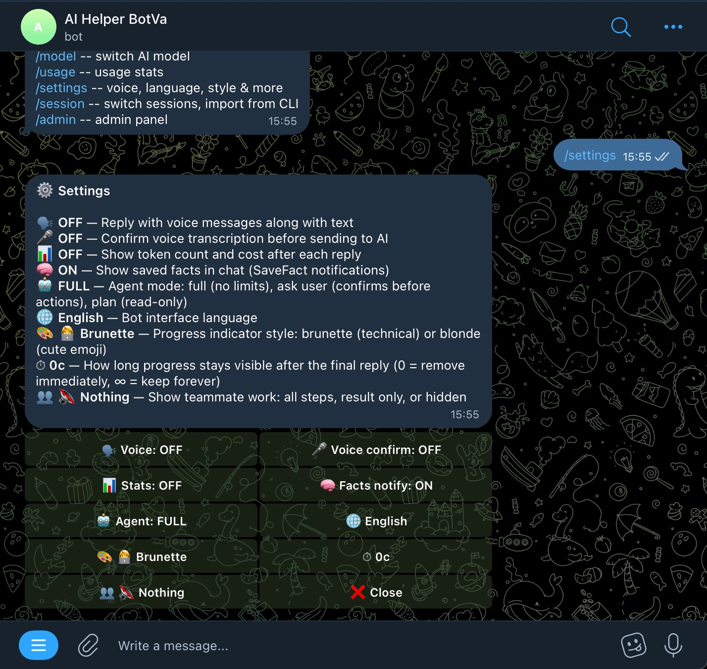
</p>
<p align="center"><em>Команди /usage, /model, /facts, /settings — управління ботом з Telegram</em></p>

| Команда | Опис |
|---------|------|
| `/start` | Привітання та chat ID |
| `/chatid` | Показати chat ID |
| `/newchat`, `/forget` | Очистити сесію (пам'ять залишається) |
| `/undo` | Відкотити останній крок — наступне повідомлення продовжить з попередньої точки |
| `/fork` | Розгалузити розмову: продовжити в новій гілці з тим самим контекстом, поточна лишається в `/session` |
| `/tasks` | Фонові задачі цієї розмови з кнопкою зупинки для кожної |
| `/secret` | Сховище секретів: `add`, `del`, `share`, `import` (логін із Google Chrome), список переданих з кнопкою «Відкликати» |
| `/voice` | Увімкнути/вимкнути голосові відповіді |
| `/img <опис>` | Згенерувати зображення |
| `/model` | Перемкнути модель чату та reasoning effort |
| `/schedule <cron> <текст>` | Створити задачу |
| `/usage` | Статистика токенів, статус Claude-логіну, ліміти підписки та ключі ElevenLabs |
| `/stats` | Inline-статистика on/off |
| `/lang` | Мова інтерфейсу |
| `/admin` | Адмін-панель |
| `/session` | Перегляд CLI-сесій |
| `/cancel` | Скасувати запит |

## Структура проекту

```
BotVa/
├── src/                    # Код платформи (TypeScript)
│   ├── index.ts            # Точка входу
│   ├── bot.ts              # Telegram бот
│   ├── agent.ts            # Claude agent з MCP
│   ├── builtin-tools.ts    # Вбудовані інструменти
│   ├── secrets.ts          # Сховище секретів, плейсхолдери, шифрування для передачі
│   ├── vault-core.ts       # Таблиця й ключ сховища (спільне для бота й адмінки)
│   ├── chrome-import.ts    # Логіни з Google Chrome на macOS
│   ├── memory.ts           # Система пам'яті
│   ├── db.ts               # SQLite
│   ├── voice.ts            # STT/TTS
│   ├── imagen.ts           # Генерація зображень
│   ├── scheduler.ts        # Планувальник
│   └── admin/              # Веб адмін-панель
├── roles/                  # Шаблони ролей
│   ├── _soul.md            # Базовий характер (для всіх ботів)
│   ├── _tools.md           # Базовий routing інструментів
│   └── *.md                # Ролі (personal-assistant, researcher, ...)
├── mcp-servers/            # MCP сервери
│   ├── colleague/          # Міжботова комунікація
│   └── manager/            # Координація менеджером
├── scripts/                # Скрипти управління
├── installer/              # Веб-інсталятор
├── bots/                   # Дані ботів (gitignored)
├── workspace/              # Runtime дані (gitignored)
├── .env.example            # Шаблон конфігурації
└── package.json
```

## Управління

```bash
./scripts/deploy.sh setup      # Встановити залежності, зібрати
./scripts/deploy.sh start      # Запустити всі боти
./scripts/deploy.sh stop       # Зупинити
./scripts/deploy.sh restart    # Перезапустити
./scripts/deploy.sh build      # Перезібрати TypeScript + MCP
./scripts/deploy.sh status     # Статус
./scripts/deploy.sh backup     # Бекап
./scripts/deploy.sh restore    # Відновлення
```

## Деплой

Детальний гайд з конфігурацією та всіма варіантами: [DEPLOY.md](DEPLOY.md)

## Технічний стек

- **Runtime**: Node.js 20+, TypeScript (strict)
- **Telegram**: Grammy
- **AI**: Anthropic Claude Agent SDK
- **Database**: SQLite (вбудований в Node.js)
- **Web**: Hono
- **Voice**: Gemini TTS / Edge-TTS / ElevenLabs (синтез), Groq Whisper (розпізнавання)
- **Images**: Google Gemini
- **Browser**: Stagehand / Playwright
- **Тести**: Vitest 4.x

## Як долучитись

Дивись [CONTRIBUTING.md](CONTRIBUTING.md).

## FAQ

**Як дізнатись свій chat ID?**
Запусти бота та надішли `/start` або `/chatid`.

**Як додати знання боту?**
Поклади .md або .txt файли в `bots/<name>/knowledge/`. Також через адмін-панель (Knowledge).

**Як підключити інтеграцію?**
Додай відповідні змінні в `.env` бота. Після перезапуску бот автоматично отримає інструменти.

**Як переїхати на інший сервер?**
Дивись розділ "Міграція" в [DEPLOY.md](DEPLOY.md).

## Ліцензія

MIT
